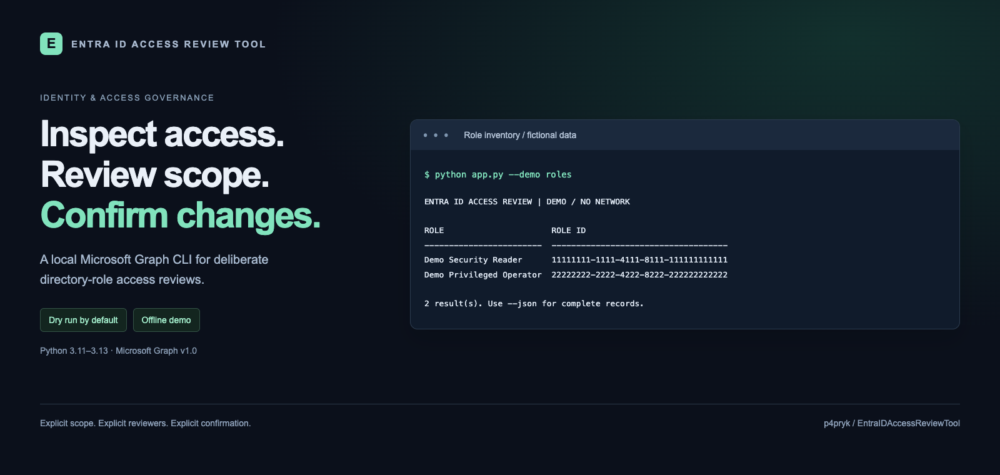
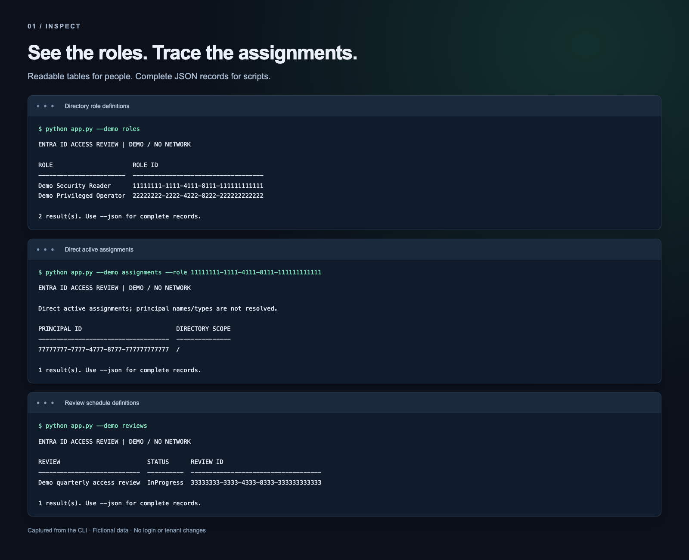
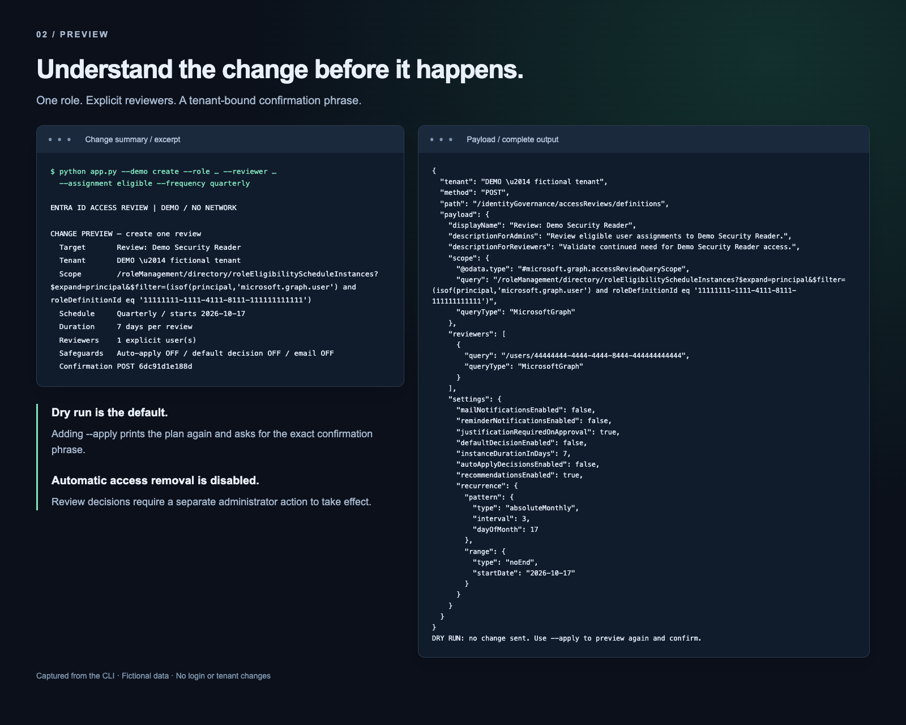

# Entra ID Access Review Tool

**Make directory-role access reviews deliberate, visible and repeatable.**

Inspect Microsoft Entra directory roles and assignments, preview a scoped access review, and require explicit confirmation before creating or deleting a review series. A small Python CLI built around Microsoft Graph, least privilege and clear operator control.

[Quick start](#try-the-offline-demo) · [Screenshots](#see-it-in-action) · [Operating guide](docs/operations.md) · [Validation](VALIDATION.md) · [Changelog](CHANGELOG.md)

## Why this tool

Privileged access deserves a clear review process. This tool makes the scope and consequences visible before a request reaches Microsoft Graph.

| Inspect | Plan | Confirm |
| --- | --- | --- |
| List role definitions, direct active assignments and existing reviews. | Target one role, choose active or eligible user assignments, and specify reviewers and a schedule. | Inspect the full plan and type its exact confirmation phrase before a write. |

Dry run is the default. Automatic application of decisions, default decisions and email notifications are disabled. The tool does not change role assignments, accounts or group memberships.

## Try the offline demo

**Python 3.11–3.13. No tenant, login or cloud resources needed.**

```bash
git clone https://github.com/p4pryk/EntraIDAccessReviewTool.git
cd EntraIDAccessReviewTool
python -m venv .venv
```

Activate the environment:

```bash
# macOS / Linux
source .venv/bin/activate
```

```powershell
# Windows PowerShell
.venv\Scripts\Activate.ps1
```

```bash
python -m pip install -r requirements.txt
python app.py --demo roles
python examples/demo.py
```

The walkthrough runs the actual CLI through a complete fictional lifecycle: inspect → preview → confirm creation → inspect the result → preview deletion → confirm deletion. It shares an in-memory fixture across commands and resets on exit. Its date is fixed for reproducibility.

## See it in action

### Inspect roles and assignments

Readable tables keep names, IDs and review status together. Add `--json` to a read command for complete records suitable for scripts.



```bash
python app.py --demo reviews
python app.py --demo roles --json
python app.py --demo assignments --role 11111111-1111-4111-8111-111111111111
```

### Preview the change

The summary exposes the target tenant, scope, schedule and safeguards. The complete payload follows it. `--apply` asks for a confirmation phrase bound to that specific plan; a wrong phrase sends no write.



```bash
python app.py --demo create \
  --role 11111111-1111-4111-8111-111111111111 \
  --reviewer 44444444-4444-4444-8444-444444444444 \
  --assignment eligible --frequency quarterly --dry-run
```

All images render captured output from the real offline CLI. They contain fictional data. The preview image separates the summary and payload for readability; it does not represent a web UI. [Full walkthrough transcript](examples/demo-transcript.txt) · [Reproduce the images](docs/visuals.md).

## Built for careful operations

- **Minimum permissions:** directory-role inspection uses `RoleManagement.Read.Directory`; access-review reads use `AccessReview.Read.All`. Writes require `AccessReview.ReadWrite.All`.
- **Bounded network behavior:** timeouts, guarded pagination and limited throttling retries. Ambiguous writes are not automatically replayed.
- **Explicit changes:** one role per creation, explicit reviewer UUIDs, dry runs and exact confirmation. Deletion previews the entire review series and checks for changes before sending the request.
- **Credential hygiene:** credentials come from the process environment; errors omit remote response bodies and secrets. Remote text is escaped for terminal display.
- **Offline verification:** deterministic fixtures, unit tests, subprocess tests and a real loopback HTTP simulator cover the main lifecycle and failure paths.

The tool reviews user assignments to Microsoft Entra directory roles. The [operating guide](docs/operations.md) covers authentication, minimum permissions, reviewer selection and supported schedules.

## Tested across Linux and Windows

**82 automated tests pass on Python 3.11, 3.12 and 3.13, with 98.80% statement coverage.** GitHub Actions also checks code quality, runtime dependency advisories and secrets.

The test suite exercises the review lifecycle against a local HTTP Graph simulator, including pagination, throttling, exact confirmation and failure handling. Live read-only checks additionally verified directory-role definitions and direct assignments. See the [test results](VALIDATION.md) and [CI runs](https://github.com/p4pryk/EntraIDAccessReviewTool/actions/workflows/ci.yml).

```bash
python -m pip install -r requirements-dev.txt
python -m ruff check .
python -m ruff format --check .
python -m pytest --cov=app --cov=entra_access_review --cov-fail-under=90
```

## Project structure

```text
app.py                  CLI, readable output and change confirmation
entra_access_review.py  Graph client, payloads, plans and offline fixture client
examples/               Fictional data and complete demo walkthrough
tests/                  Unit, CLI and loopback HTTP integration tests
docs/                   Operating guide and reproducible README visuals
.github/workflows/      CI checks; no tenant secrets required
```

The implementation focuses on access governance with a small Python codebase. See [CHANGELOG.md](CHANGELOG.md) for the migration from the original menu-based version.
